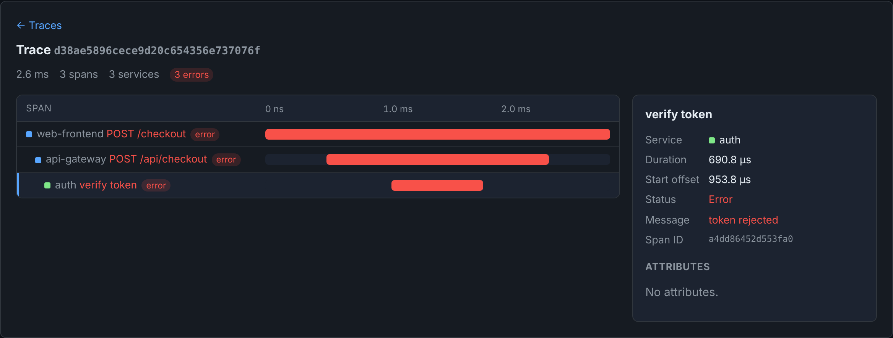
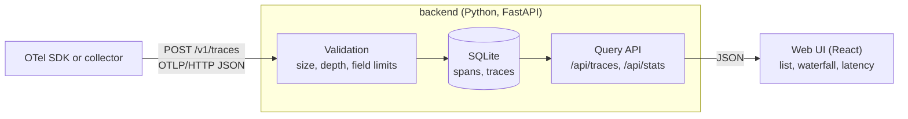

# trace-lens

A small self-hosted OpenTelemetry trace backend and UI: it accepts OTLP/HTTP JSON, stores spans in SQLite, and shows each trace as a waterfall.

## Why it is hard

- **Untrusted input.** Any client can post to `POST /v1/traces`. The body is streamed under a size cap, JSON nesting is checked before decoding, every field is validated by hand, and a batch with some bad spans is partially accepted instead of rejected whole.
- **Trace trees are not trees.** Spans arrive out of order, parents can be missing (orphans), and a malicious or buggy client can send parent cycles. Tree assembly must still produce a complete, ordered waterfall without recursion or crashes.
- **Queries under load.** The UI needs filtered, paginated trace lists with stable cursors when many traces share a start time, and latency percentiles with a histogram, all from indexed SQLite tables.



The trace list, filtered to traces with errors, is in [`docs/list.png`](docs/list.png).

## Architecture



- `backend/src/tracelens/otlp.py` parses and validates a request. It is pure and never raises.
- `backend/src/tracelens/store.py` writes spans idempotently and keeps a `traces` summary table in the same transaction.
- `backend/src/tracelens/tree.py` builds the waterfall rows from a trace's spans.
- `web/` is the React UI; `waterfall.ts` holds the pure layout code.

See [`docs/DESIGN.md`](docs/DESIGN.md) for the full design.

## Quick start

Requirements: Node.js 22.12 or later, Python 3.11 or later, and [uv](https://docs.astral.sh/uv/).

```bash
npm ci
(cd backend && uv sync --locked)
(cd backend && uv run python -m tracelens.demo --db trace-lens.db)
npm run dev
```

Then open <http://127.0.0.1:5173>. The first command installs the frontend, the second installs the backend from `uv.lock`, the third writes 300 seeded demo traces to `backend/trace-lens.db`, and `npm run dev` starts the API on `127.0.0.1:4318` and the UI on `127.0.0.1:5173`.

The database path is relative to the working directory of the API process. `npm run dev` runs the API from `backend/`, so it reads the same `backend/trace-lens.db` that the demo wrote.

To send the demo traces to a running server instead of writing the database directly:

```bash
(cd backend && uv run python -m tracelens.demo --url http://127.0.0.1:4318 --traces 300 --seed 42)
```

## Usage

### Send traces from an OpenTelemetry SDK

The backend accepts the standard OTLP/HTTP JSON wire format at `POST /v1/traces`. Configure an SDK or collector with the standard environment variables:

```bash
export OTEL_EXPORTER_OTLP_PROTOCOL=http/json
export OTEL_EXPORTER_OTLP_ENDPOINT=http://127.0.0.1:4318
```

The SDK appends `/v1/traces` to the endpoint. Protobuf and gzip are not supported (see limitations). This integration follows the OTLP JSON mapping, but the repository has no test that runs a real SDK against the server, so treat it as unverified until you try it.

### Query the API

```bash
curl -s 'http://127.0.0.1:4318/api/services'
curl -s 'http://127.0.0.1:4318/api/traces?service=checkout&error=true&limit=10'
curl -s 'http://127.0.0.1:4318/api/traces/<32-hex trace id>'
curl -s 'http://127.0.0.1:4318/api/stats/latency?service=checkout'
```

| Endpoint | Purpose |
|---|---|
| `POST /v1/traces` | OTLP/HTTP JSON ingestion |
| `GET /api/services` | Service names |
| `GET /api/traces` | Trace summaries, newest first, with filters and a cursor |
| `GET /api/traces/{trace_id}` | Waterfall rows of one trace, with orphan count |
| `GET /api/stats/latency` | p50, p95, p99 and histogram over recent matching spans |
| `GET /api/healthz` | Health check |

### Run the backend alone

```bash
(cd backend && HOST=127.0.0.1 PORT=4318 DB_PATH=trace-lens.db uv run python -m tracelens)
```

## Design decisions and trade-offs

- **OTLP/HTTP JSON only.** It is the wire format defined by OpenTelemetry for HTTP, it is easy to inspect, and it avoids a protobuf dependency. The cost is larger payloads and no protobuf clients.
- **SQLite with one guarded connection.** It keeps the system a single process with no external services. The store uses one connection guarded by a lock, so reads and writes are serialized within the process.
- **Idempotent ingestion.** Spans use a primary key of `(trace_id, span_id)` with `INSERT OR IGNORE`, so re-sending a batch does not duplicate spans.
- **Summaries kept in a table.** The `traces` table is recomputed for touched traces in the same transaction, so list queries do not scan spans.
- **Cursor pagination on `(start_ns, trace_id)`.** Traces that share a start time are neither skipped nor repeated across pages.
- **Partial success.** A valid request with some bad spans stores the good spans and reports the rest in the OTLP `partialSuccess` field, instead of rejecting the batch.
- **Pure parsing and tree code.** `otlp.py`, `tree.py` and `stats.py` have no I/O, which makes them easy to test with property-based tests.
- **Iterative tree assembly.** The waterfall builder uses an explicit stack, so a 10 000-deep chain does not hit Python's recursion limit.
- **Hand-written SVG and CSS.** The waterfall and histogram use no charting library.

### Limits

Ingestion limits are constants in `backend/src/tracelens/config.py`. They are not configurable from the environment, so a deployment cannot raise the cost of untrusted input by accident.

| Limit | Value |
|---|---|
| Request body | 4 MiB, enforced while streaming |
| Spans per request | 10 000 |
| Span name and service name | 256 characters |
| Attributes per span (including resource attributes) | 64 |
| Attribute key | 128 characters |
| Attribute string value | 4 096 characters |
| Status message | 1 024 characters |
| JSON nesting depth | 32 |
| `GET /api/traces` `limit` | 500 maximum |
| Latency statistics window | last 10 000 matching spans |
| Concurrent requests (uvicorn) | 64 |
| Keep-alive timeout (uvicorn) | 5 seconds |

### Trace tree invariants

`build_tree` turns a trace's spans into waterfall rows. It is tested with hypothesis against these invariants:

- every input span appears exactly once in the output;
- a parent row comes before its children;
- the depth of a child is one more than the depth of its parent;
- roots have depth 0;
- the output does not depend on the input order;
- the function never raises.

Rules for inputs that are not a clean tree:

- a span whose parent is missing is treated as a root and counted as an orphan;
- for duplicate span ids, the first one is kept;
- a parent cycle is broken by treating the earliest-starting span of the cycle as a root.

## Testing

| Layer | Tool | What it covers |
|---|---|---|
| Backend unit and API | pytest, FastAPI `TestClient` | Ingestion limits at the boundary, partial success, status codes, query bounds, storage, statistics, demo determinism |
| Backend properties | hypothesis | Arbitrary JSON never crashes the parser; tree invariants above |
| Frontend unit | vitest | Waterfall layout, formatting, filters, routing, API client |
| End to end | Playwright | Browse the list, filter, open a trace, inspect a span, view latency |

Run the checks from the repository root unless noted:

```bash
npm run typecheck
npm run lint
npm test
(cd backend && uv run ruff check . && uv run ruff format --check . && uv run mypy --strict src/tracelens && uv run pytest -q)
PW_CHROMIUM=<path to a Chromium executable> npm run e2e -- --trace off
```

The Playwright run starts its own API on a temporary database seeded with demo traces, and the Vite dev server. Without `PW_CHROMIUM`, Playwright uses the browser it manages; install it with `npx playwright install chromium`. The screenshots in `docs/` are generated by `e2e/screenshot.spec.ts`:

```bash
PW_CHROMIUM=<path to a Chromium executable> npm run e2e -- --trace off -g screenshot
```

## Limitations

- **No authentication or authorization.** Anyone who can reach the API can read and write traces. The server binds to `127.0.0.1` by default; to expose it, put it behind a reverse proxy that enforces authentication.
- **JSON only.** Protobuf is not supported. Requests with a `Content-Type` other than `application/json` are refused with `415`.
- **No compression.** Requests with a `Content-Encoding` other than identity (for example gzip) are refused with `415`. Exporters must send uncompressed bodies.
- **Exact percentiles over a recent sample.** Latency percentiles are exact nearest-rank values over the last 10 000 matching spans, not over all data. There is no streaming percentile estimator yet.
- **Single node.** One process and one SQLite file. There is no replication, clustering, or horizontal scaling.
- **No retention.** Traces are kept until the database is removed by hand.
- **Data is stored unencrypted.** Span attributes are stored in plain text in SQLite. Protect the database file with file permissions and do not record secrets in span attributes.
- **Demo timestamps are fixed.** The demo timeline starts on 2023-11-14, so the UI shows relative times such as "N days ago". Pass `--now` to the demo generator to anchor the timeline to the current time.
- **The UI runs in the Vite dev server.** The repository has no production build or static serving path for the web UI yet.
- **Not yet implemented:** service map, aggregated flame graph, SLO alerts, gzip, retention, and container packaging.

## License

[MIT](LICENSE). Copyright (c) 2026 Juan Diego Valdés M.
